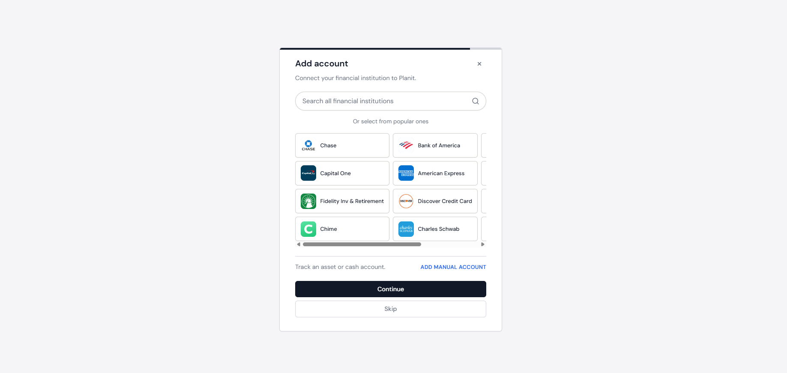

# Planit — Personal Budgeting App

A simple, YNAB-style personal budgeting web app with onboarding, configuration, dashboard, transactions, and reports. Uses mock data.


## Screenshots


<table>
  <tr>
    <td align="center" width="50%">
      
      <br>
      <sub><b>Dashboard</b></sub>
    </td>
    <td align="center" width="50%">
      
      <br>
      <sub><b>Onboarding</b></sub>
    </td>
  </tr>
  <tr>
    <td align="center" width="50%">
      
      <br>
      <sub><b>Budget</b></sub>
    </td>
    <td align="center" width="50%">
      
      <br>
      <sub><b>Transactions</b></sub>
    </td>
  </tr>
</table>

## Run

```bash
npm install
npm run dev
```

Open http://localhost:5173

## Tech

- React 18, Vite, React Router
- Recharts for graphs
- Mock data in `src/data/mockData.js` and app state in `src/context/AppContext.jsx`
