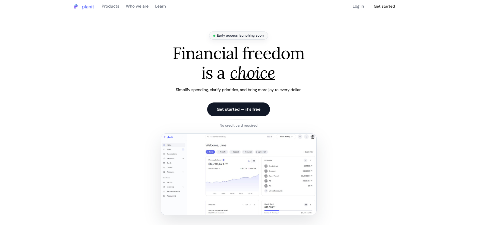
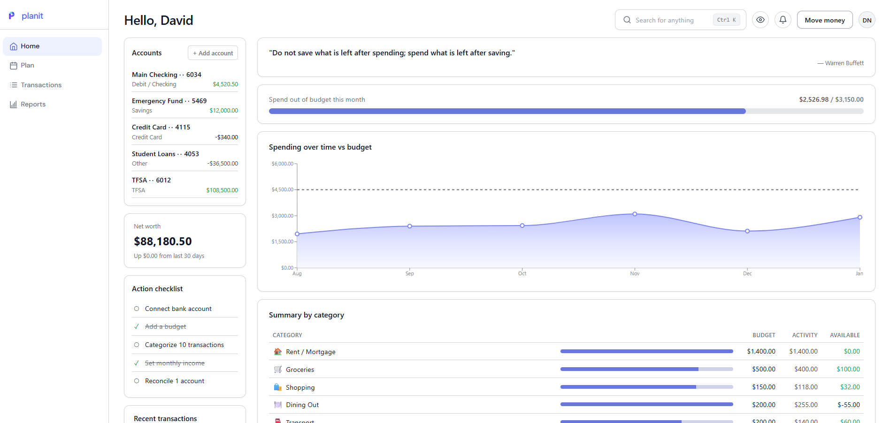
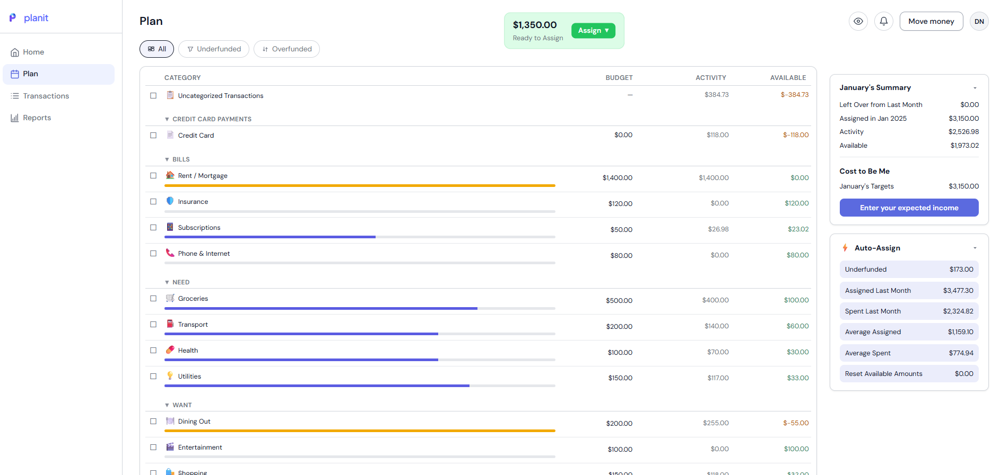
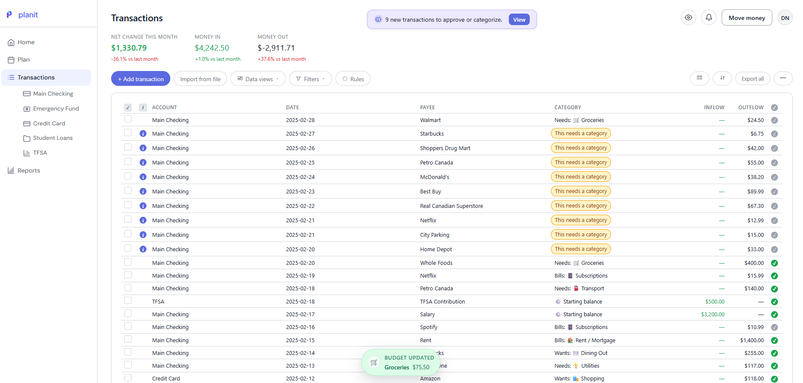
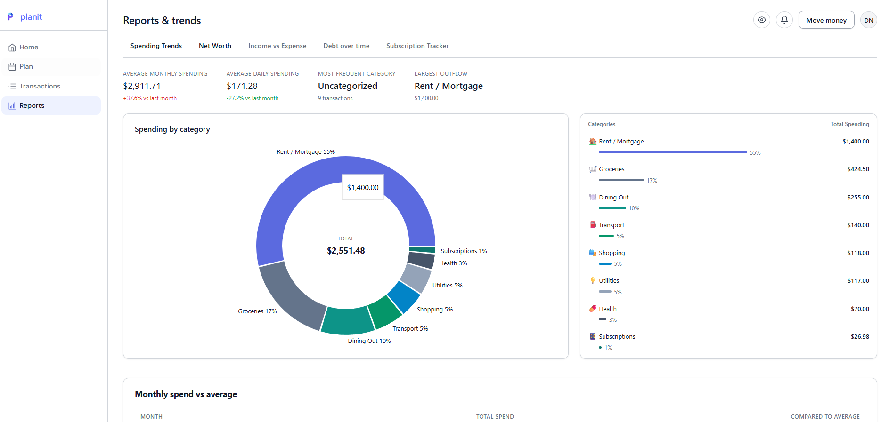

# Planit — Personal Budgeting App

A simple, YNAB-style personal budgeting web app with onboarding, configuration, dashboard, transactions, and reports. Uses mock data.




## Screenshots


<h3 align="center">Dashboard</h3>
<p align="center">
  
</p>

---

<h3 align="center">Budget</h3>
<p align="center">
  
</p>

---

<h3 align="center">Transactions</h3>
<p align="center">
  
</p>

---

<h3 align="center">Reports</h3>
<p align="center">
  
</p>


## Run

```bash
npm install
npm run dev
```

Open http://localhost:5173

## Tech

- React 18, Vite, React Router
- Recharts for graphs
- Mock data in `src/data/mockData.js` and app state in `src/context/AppContext.jsx`
